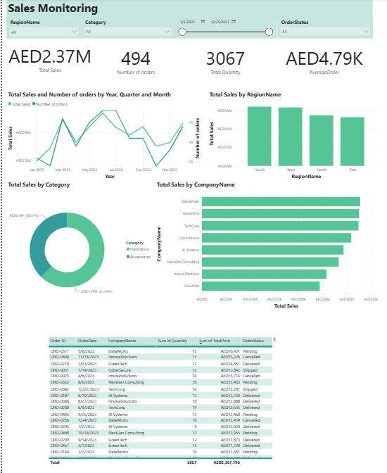
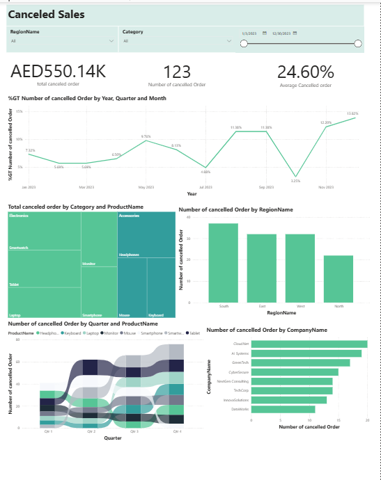

# PowerBi-Sales-Analysis

## Project Overview

This project was developed as part of a guided Power BI learning program. It focuses on sales performance monitoring and cancelled order analysis using an interactive Power BI report.
The project covers data preparation, data modeling, DAX measures, KPI tracking, and interactive data visualization.

## Project Objectives

- Monitor overall sales performance.

- Analyze sales trends over time.

- Compare sales across regions and product categories.

- Track cancelled orders and their associated value.

- Calculate key performance indicators.

- Explore sales data using interactive filters.

## Tools and Technologies

- Power BI Desktop — Report development and data visualization.

- Power Query — Data preparation and transformation.

- DAX — Measures and KPI calculations.

- Data Modeling — Relationships between sales, customers, products, and regions.

## Dashboard 1: Sales Monitoring

This dashboard provides an overview of sales performance.

### Key indicators:

* Total Sales

* Number of Orders

* Total Quantity

* Average Order Value

Visualizations include sales trends over time, sales by region, sales by product category, and a detailed order table.

Interactive filters allow users to explore the data by date, order status, and region.

## Dashboard 2: Cancelled Sales Analysis

This dashboard focuses on cancelled orders and their associated sales value.

The analysis includes:

* Number of Cancelled Orders

* Cancelled Order Value

* Cancellation Rate

* Monthly cancellation trends

* Cancellation analysis by region

* Cancelled order value by product category and product

The report includes filters to explore cancellation patterns across dates, regions, and product categories.

## Data Model

The model includes a sales table and three dimension tables:

1. Sales — Order-level line items, quantities, prices, dates, and order statuses.

2. Customers — Customer identifiers and names.

3. Products — Product identifiers, names, and categories.

4. Regions — Region identifiers and names.

The dimension tables are related to the sales table to support analysis across customers, products, and regions.

## Key DAX Measures

Examples of measures used in the project include:

Total Sales =
SUM(sales[TotalPrice])

Number of Orders =
DISTINCTCOUNT(sales[Order ID])

Total Quantity =
SUM(sales[Quantity])

Average Order Value =
DIVIDE(
    [Total Sales],
    [Number of Orders]
)

Number of Cancelled Orders =
CALCULATE(
    DISTINCTCOUNT(sales[Order ID]),
    sales[OrderStatus] = "cancelled"
)

Cancelled Order Value =
CALCULATE(
    SUM(sales[TotalPrice]),
    sales[OrderStatus] = "cancelled"
)

The cancellation rate is calculated as cancelled orders divided by total orders, with the denominator including all order statuses for the selected reporting period and other applicable filters.

## Skills Demonstrated

Data preparation with Power Query

Data modeling and table relationships

DAX measures and KPI calculations

Interactive dashboard development

Sales performance analysis

Cancelled order analysis

Data visualization

## Project Background

This project was completed as part of a guided learning program. It provided practical experience in developing Power BI reports, creating DAX measures, modeling data, and building interactive dashboards.

## 📊 Dashboard Preview

### 1. Sales Monitoring Dashboard

This dashboard provides an overview of sales performance through key performance indicators, monthly sales trends, regional sales, category distribution, and company performance.

### 2. Canceled Sales Dashboard

This dashboard analyzes canceled orders, including cancellation rates, canceled sales amounts, product analysis, and cancellation distribution across regions and companies.

## 📁 Power BI Project File

You can download the Power BI project file (.pbix) here:

[📥 Download Power BI Project](PowerBi_Sales-Analysis/Sales.pbix)
  
